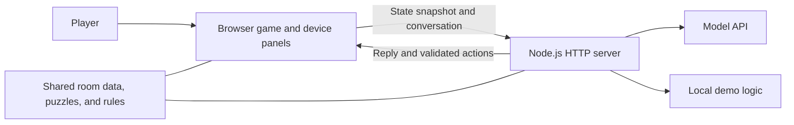
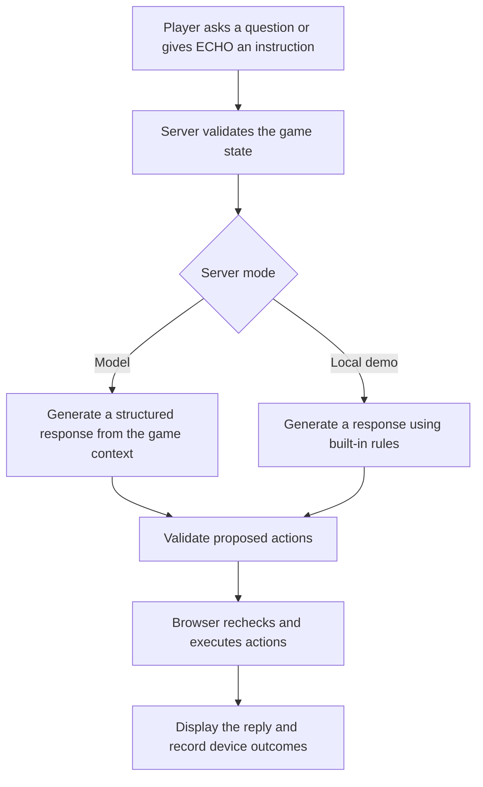

# The Last Protocol · AI-Powered Escape Room

The Last Protocol is a COMP5140 course project. Explore a pixel-art laboratory, investigate an incident, restore backup cooling, and verify an evacuation route. Use natural language to coordinate your escape with ECHO, the lab's central AI.

**[Play The Last Protocol online](https://escape-with-echo.onrender.com/)**

## Quick Start

You need **Node.js 20.12.0 or later**. The project uses built-in Node.js modules. From the repository root, run the following command.

```sh
node server.mjs
```

Open [http://127.0.0.1:8788](http://127.0.0.1:8788) to play. The default local demo mode uses built-in rules for ECHO's replies and device assistance. It requires no API key.

## Controls and Gameplay

| Action | Keyboard |
| --- | --- |
| Move | WASD or arrow keys |
| Inspect a nearby object | E |
| Open ECHO communications | Q |

Walk through doorways to move between rooms. The minimap shows your current location and the rooms you've visited. On mobile, use the on-screen directional controls and inspect button.

1. **Investigate the incident.** Collect the staff badge and research log in the research lab. In the archives, ask ECHO to recover the cabinet's timing records. Use the clues to reconstruct the experiment sequence and unlock the incident report in the control room. Then collect the report fragments scattered throughout the lab. If you get stuck, ask ECHO where to look or review the clues you've already collected. Once you have all the fragments, return to the control room terminal to read the report.
2. **Restore cooling.** Collect the coupler in the maintenance room and run a pressure test. Rotate pipe segments to repair the system, or ask ECHO to bypass the leak marked during the test.
3. **Verify an evacuation route.** Ask ECHO to scan routes A and B. Find the acceptance criteria at the differential pressure gauge in the service corridor, the microscope in the research lab, and the group photo in the archives. Verify the criteria and select a route at the exit inspection station.
4. **Evacuate.** Enter the airlock and wait for the inner door to close fully before cutting power. You can also install the spare door sensor so ECHO can cut power when the inner door closes. Once the outer door opens, step through on the side marked by the green light.

Starting a new game randomizes the cause of the incident, puzzle values, pipe orientations, and which route meets the evacuation criteria.

## Model Setup

**Online play requires no API key.** To use DeepSeek with a local installation, provide your own DeepSeek API key.

Copy [`.env.example`](.env.example) to `.env` in the repository root. In PowerShell, run `Copy-Item .env.example .env`. Fill in the model settings and restart the server.

| Variable | Purpose |
| --- | --- |
| `ECHO_API_BASE` | Provider API base URL. The server appends `/chat/completions`. |
| `ECHO_MODEL` | Model ID. The model must support Chat Completions and JSON object responses. |
| `ECHO_API_KEY` | API key used by the server. |
| `ECHO_PORT` | Local port. Defaults to `8788`. |
| `PORT` | Port supplied by the hosting environment. It takes precedence over `ECHO_PORT` and binds the server to `0.0.0.0`. |

Process environment variables take precedence over `.env`. Leave the API base URL and model blank in the game settings to use the server defaults. If you enter an API base URL in the browser, it must match the server configuration. Configure the API key on the server.

## Architecture



### How ECHO Helps Solve Puzzles

The browser sends the player's message and a game state snapshot to the server. The server uses the player's progress and available actions to generate a response. ECHO can report scan readings, recover timing records, and help operate devices. The model prompt supplies the game context. The server validates proposed actions, and the browser checks them again against the current state before executing them. The outcome of each device action is included in the next turn so ECHO can respond to what actually happened.



The in-game debug log shows the game state, ECHO's latest decision, and the results of device actions. See the [LLM integration notes (Chinese)](docs/成员3-LLM联调记录.md) for model integration scenarios and error cases.

### HTTP API

| Method and path | Purpose |
| --- | --- |
| `GET /api/health` | Check whether ECHO is configured and which mode is active. |
| `POST /api/echo/config` | Check the ECHO configuration. |
| `POST /api/echo` | Send the game state and a player message to get ECHO's response. |

## Tech Stack and Repository Layout

| Layer | Technology and responsibilities |
| --- | --- |
| Frontend | HTML, CSS, and JavaScript ES modules for map rendering, player controls, and device panels. |
| Backend | Node.js built-in HTTP module for serving static files, validating requests, and calling the model API. |
| AI | Chat Completions-compatible model API with a rule-based local demo mode. |
| Testing | Node.js built-in test runner for rooms, airlock behavior, ECHO debug logs, and evacuation flows. |

```text
.
├── server.mjs       # Server entry point
├── frontend/        # Game UI, rendering, device panels, and static assets
├── backend/         # HTTP server, ECHO context, and local demo logic
├── shared/          # Shared rooms, puzzles, rules, and translations
├── tests/           # Automated tests
└── docs/            # Integration notes and acceptance test data
```

Run the tests from the repository root.

```sh
node --test
```

Font licenses are available in the [font licenses directory](frontend/assets/fonts/licenses/) and the [OFL text](frontend/assets/fonts/OFL.txt).
